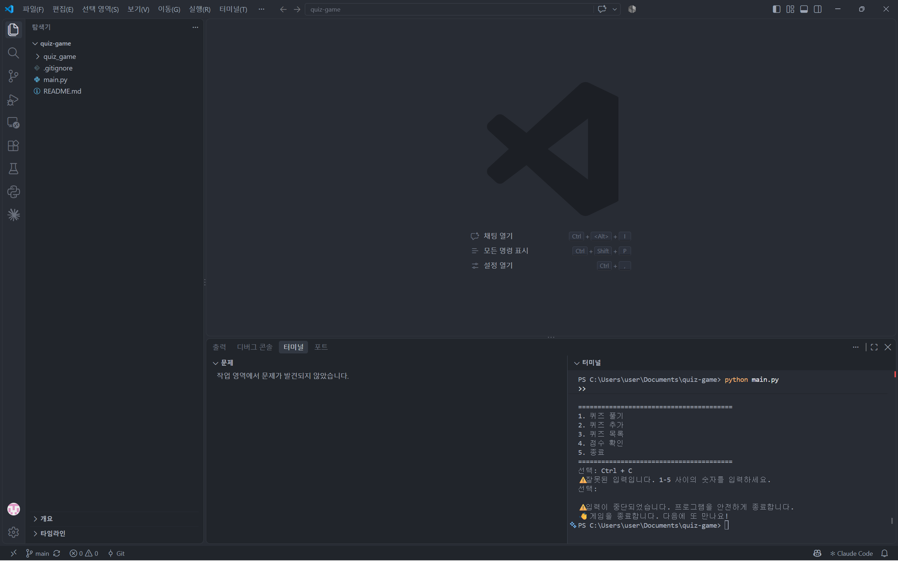
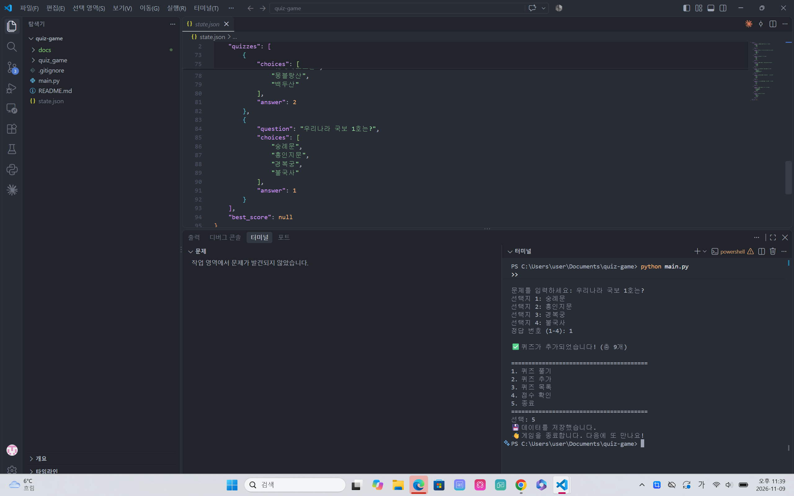
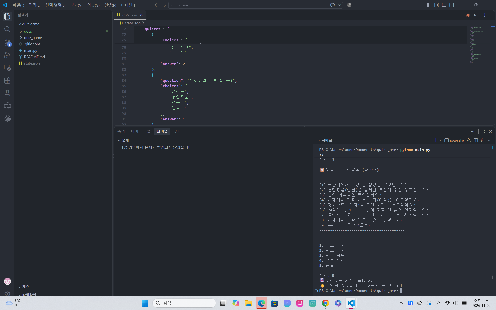
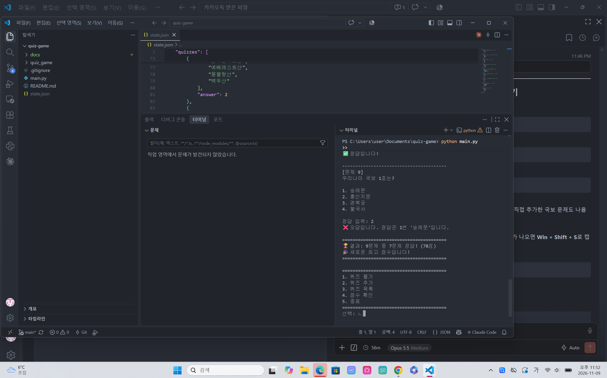
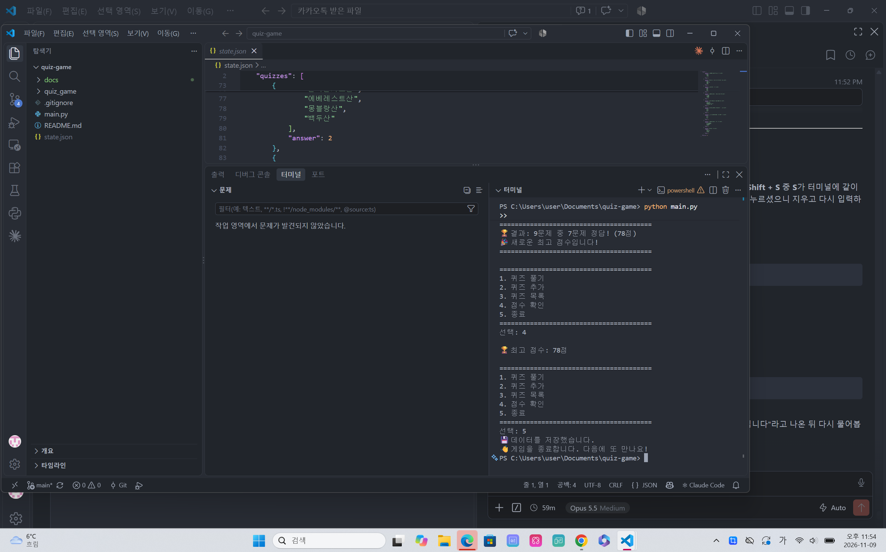

# 🎯 나만의 퀴즈 게임

터미널에서 동작하는 **일반 상식 퀴즈 게임**입니다.
Python 기본 문법과 클래스로 구현했고, 퀴즈와 최고 점수를 `state.json` 파일에 저장하기 때문에 프로그램을 종료했다가 다시 실행해도 데이터가 유지됩니다.

---

## 1. 프로젝트 개요

| 항목 | 내용 |
|---|---|
| 프로그램 종류 | Python 콘솔(터미널) 프로그램 |
| 주요 기능 | 퀴즈 풀기, 퀴즈 추가, 퀴즈 목록, 점수 확인 |
| 데이터 저장 | 프로젝트 루트의 `state.json` (UTF-8, JSON 형식) |
| 개발 환경 | Python 3.14 (3.10 이상 필요), VSCode, Git, Windows 11 |
| 외부 라이브러리 | 사용하지 않음 (표준 라이브러리 `json`, `os`, `pathlib`, `random`만 사용) |

이 프로젝트의 목표는 다음과 같습니다.

- 입력 → 처리 → 출력의 흐름을 가진 프로그램을 처음부터 끝까지 직접 완성하기
- 클래스로 역할을 나누어 코드를 구조화하기
- JSON 파일 저장으로 **데이터 영속성**(종료 후에도 데이터 유지) 경험하기
- Git으로 기능 단위 커밋, 브랜치 생성·병합, 원격 저장소 push/pull/clone 경험하기

---

## 2. 퀴즈 주제와 선정 이유

**주제: 일반 상식** (과학, 역사, 지리, 예술, 스포츠 등)

처음에는 Python & Git 기초를 주제로 정했지만, 직접 플레이하며 즐겁게 풀 수 있는 퀴즈가 더 좋겠다고 생각해 **일반 상식**으로 바꾸었습니다.
상식 문제는 **제가 많이 맞힐 수 있는 문제**라서 게임을 하는 재미가 있고, 여러 분야를 고르게 담을 수 있어 누구나 부담 없이 함께 풀 수 있습니다.

기본 퀴즈 8개 (모두 힌트 포함):

| # | 문제 | 분야 |
|---|---|---|
| 1 | 태양계에서 가장 큰 행성은? | 과학 |
| 2 | 훈민정음(한글)을 창제한 조선의 왕은? | 역사 |
| 3 | 물의 화학식은? | 과학 |
| 4 | 세계에서 가장 넓은 바다(대양)는? | 지리 |
| 5 | 명화 '모나리자'를 그린 화가는? | 예술 |
| 6 | 24절기 중 1년에서 낮이 가장 긴 날은? | 생활 |
| 7 | 올림픽 오륜기에 그려진 고리의 개수는? | 스포츠 |
| 8 | 세계에서 가장 높은 산은? | 지리 |

---

## 3. 실행 방법

### 준비

- Python **3.10 이상**이 설치되어 있어야 합니다. 버전 확인:

  ```bash
  python --version
  ```

### 실행

```bash
git clone https://github.com/leejuran/quiz-game.git
cd quiz-game
python main.py
```

- 첫 실행 시 `state.json`이 없으므로 기본 퀴즈 8개로 시작하고, 종료할 때 `state.json`이 자동으로 만들어집니다.
- 메뉴에서 번호(1~5)를 입력해 기능을 선택합니다.

---

## 4. 기능 목록

### 필수 기능

| 메뉴 | 기능 | 설명 |
|---|---|---|
| 1 | 퀴즈 풀기 | 퀴즈를 출제하고 정답(1~4)을 입력받아 정답/오답을 알려 줌. 오답이면 정답을 함께 안내. 다 풀면 결과(맞힌 개수, 100점 만점 점수) 표시 |
| 2 | 퀴즈 추가 | 문제, 선택지 4개, 정답 번호, 힌트(선택)를 입력받아 등록하고 즉시 파일에 저장 |
| 3 | 퀴즈 목록 | 등록된 퀴즈의 번호와 문제를 출력 (정답은 숨김) |
| 4 | 점수 확인 | 최고 점수 출력. 퀴즈를 마칠 때마다 최고 점수와 비교해 갱신하고 저장 |
| 5 | 종료 | 데이터를 저장하고 종료 |

### 보너스 기능

| 기능 | 설명 |
|---|---|
| 랜덤 출제 | `random.sample`로 매번 문제 순서를 무작위로 섞음 (원본 목록 순서는 유지) |
| 문제 수 선택 | 퀴즈 시작 전 몇 문제를 풀지 선택 (1 ~ 등록된 퀴즈 수) |
| 힌트 | 풀이 중 `h`(한글 자판 상태의 `ㅗ`도 인정)를 입력하면 힌트 표시. 힌트를 본 문제는 맞혀도 **0.5문제**로 계산 |

### 입력·예외 처리

| 상황 | 처리 |
|---|---|
| 입력 앞뒤 공백 (예: ` 1 `) | 공백 제거 후 정상 처리 |
| 빈 입력 (그냥 Enter) | 안내 메시지 후 다시 입력 |
| 숫자가 아닌 입력 (예: `abc`) | 안내 메시지 후 다시 입력 |
| 범위 밖 숫자 (예: 메뉴 `9`, 정답 `0`) | 안내 메시지 후 다시 입력 |
| 이미 있는 문제 / 중복 선택지 입력 | 안내 메시지 후 다시 입력 |
| Ctrl+C (`KeyboardInterrupt`), 입력 종료 (`EOFError`) | 오류 화면 없이 안내 → 데이터 저장 → 안전하게 종료 |
| `state.json` 없음 | 기본 퀴즈로 시작 |
| `state.json` 손상 (JSON 형식 오류, 잘못된 값) | 안내 → 손상 파일을 `state.json.corrupted`로 보관 → 기본 퀴즈로 복구 |
| 파일 저장 실패 | 안내 메시지 출력 (프로그램은 계속 동작) |

### 점수 계산 방법

```
점수 = (힌트 없이 맞힌 문제 수 × 1 + 힌트 보고 맞힌 문제 수 × 0.5) ÷ 푼 문제 수 × 100  (반올림)
```

예) 9문제 중 7문제를 힌트 없이 맞힘 → 7 ÷ 9 × 100 ≈ **78점**

---

## 5. 실행 화면

### 메뉴 / 잘못된 입력 처리


### 퀴즈 추가


### 퀴즈 목록


### 퀴즈 풀기


### 점수 확인


---

## 6. 파일 구조

```
quiz-game/
├── main.py                  # 실행 파일 (python main.py)
├── quiz_game/               # 게임 코드 패키지
│   ├── __init__.py          # 패키지 표시 파일
│   ├── quiz.py              # Quiz 클래스: 퀴즈 한 문제 (문제, 선택지, 정답, 힌트)
│   ├── default_data.py      # 기본 퀴즈 8개 생성
│   ├── game.py              # QuizGame 클래스: 메뉴, 퀴즈 풀기/추가/목록/점수, 저장·불러오기
│   ├── storage.py           # StateStorage 클래스: state.json 읽기/쓰기, 손상 파일 보관
│   └── input_utils.py       # 입력 검사 함수 (read_int, read_text 등)
├── docs/
│   └── screenshots/         # README용 실행 화면
├── state.json               # 실행 중 생성되는 데이터 파일 (Git에는 올리지 않음)
├── .gitignore               # Git에서 제외할 파일 목록
└── README.md                # 프로젝트 설명서 (이 문서)
```

### 클래스별 역할

| 클래스 / 모듈 | 역할 | 주요 메서드·함수 |
|---|---|---|
| `Quiz` | 퀴즈 한 문제 | `display()` 퀴즈 출력, `is_correct()` 정답 확인, `has_hint()`, `to_dict()` / `from_dict()` 저장용 변환 |
| `QuizGame` | 게임 전체 진행 | `run()`, `show_menu()`, `play_quiz()`, `ask_answer()`, `show_result()`, `add_quiz()`, `show_quizzes()`, `show_score()`, `load_state()`, `save_state()` |
| `StateStorage` | 파일 입출력 | `load()`, `save()`, `backup_corrupted()` |
| `input_utils` | 입력 검사 | `read_int()`, `read_text()`, `read_optional_text()`, `parse_int()` |

---

## 7. 데이터 파일 설명 (`state.json`)

| 항목 | 내용 |
|---|---|
| 경로 | 프로젝트 루트 `quiz-game/state.json` |
| 역할 | 퀴즈 목록과 최고 점수를 저장해, 프로그램을 다시 실행해도 데이터가 유지되게 함 |
| 인코딩 | UTF-8 (한글을 그대로 저장) |
| 저장 시점 | 퀴즈 추가 직후, 최고 점수 갱신 직후, 프로그램 종료 시 (Ctrl+C 포함) |
| Git 관리 | 사용자별 플레이 기록이므로 `.gitignore`로 제외 |

### 필드 구조

| 필드 | 자료형 | 설명 |
|---|---|---|
| `quizzes` | list | 퀴즈 목록 |
| `quizzes[].question` | str | 문제 |
| `quizzes[].choices` | list[str] | 선택지 4개 |
| `quizzes[].answer` | int | 정답 번호 (1~4) |
| `quizzes[].hint` | str | 힌트 (없으면 빈 문자열 `""`) |
| `best_score` | int 또는 null | 최고 점수 (0~100). 아직 퀴즈를 푼 적이 없으면 `null` |

### 예시

```json
{
    "quizzes": [
        {
            "question": "태양계에서 가장 큰 행성은 무엇일까요?",
            "choices": ["화성", "목성", "토성", "지구"],
            "answer": 2,
            "hint": "줄무늬와 '대적점'이라는 거대한 소용돌이가 있는 행성이에요."
        }
    ],
    "best_score": 78
}
```

### 관련 파일

| 파일 | 설명 |
|---|---|
| `state.json.tmp` | 저장 중에 잠깐 생기는 임시 파일. 저장이 끝나면 `state.json`으로 바뀜 (저장 도중 문제가 생겨도 기존 파일이 망가지지 않도록) |
| `state.json.corrupted` | 손상된 `state.json`을 발견했을 때 보관해 둔 원본 |

---

## 8. Git 작업 방식

- **기능 단위 커밋**: 메뉴 → Quiz 클래스 → 기본 데이터 → 퀴즈 풀기 → 저장 → 추가 → 목록 → 점수 → 구조 정리 → 보너스 → README 순서로 커밋
- **커밋 메시지 규칙**: `Feat:` 기능 추가, `Fix:` 오류 수정, `Refactor:` 구조 개선, `Docs:` 문서, `Chore:` 설정
- **브랜치 활용**: 퀴즈 풀기 기능은 `feature/play-quiz` 브랜치에서 개발한 뒤 `main`에 병합 (`git merge --no-ff`)
- **사용한 Git 명령어**: `init`, `add`, `commit`, `push`, `checkout`, `merge`, `clone`, `pull`
- **clone/pull 실습**: 이 줄은 복제한 저장소(quiz-game-clone)에서 추가한 뒤 push했습니다.


